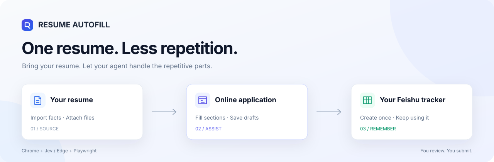
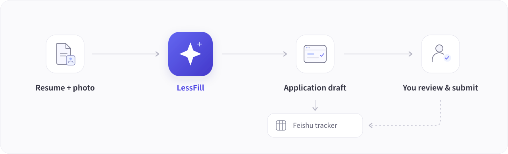
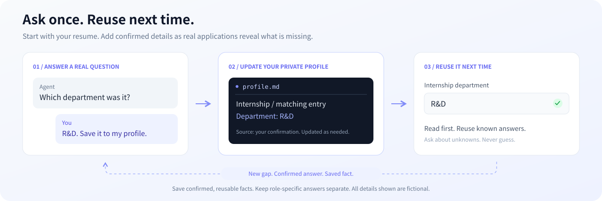
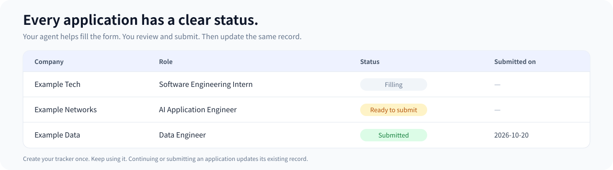

<div align="center">



# LessFill

[简体中文](README.md) · **English**

**Less time filling forms. More time preparing for interviews.**

Let your AI agent fill application forms from your resume, upload attachments, and keep your applications in your own Feishu table.

[](LICENSE)
[](resume-autofill/SKILL.md)
[](#current-status)

[Get started](#get-started) · [Build your profile as you go](#build-your-profile-as-you-go) · [Choose a browser](#choose-a-browser) · [Connect Feishu](#connect-feishu)

</div>

---

> **Shaped by the author's personal experience submitting 300 job applications.**
>
> I refined this skill while applying for jobs myself: filling forms, fixing failures, and adjusting the workflow. It's the best version I've put together so far. I'm sharing it so you can spend less time working through the same problems.

A new career site, the same education history, internships, projects, and awards. Once the attachments are uploaded, there's still an application tracker to update.

LessFill turns those repetitive steps into a reusable Agent Skill. Give it your resume, photo, and a job link. Your agent fills the fields the page actually asks for and saves a draft where possible. You do the final review and submission.

This is a workflow for an AI agent to follow. **Your AI tool needs file access and browser control. Installing the skill does not install browser extensions or set up service accounts.**

## The workflow at a glance



## What you provide, what it handles

|You provide|The skill handles|
|:---|:---|
|A resume file path or accessible link|Extracts relevant facts for reuse; your corrections take priority over an older resume|
|An optional photo|Uploads it when the form requires it and the tools support it; never substitutes a resume screenshot|
|A job application link|Identifies the company, role, and fields; fills sections without adding duplicate experience entries|
|Your browser choice|Uses Chrome + Jev or Edge + Playwright in the corresponding session|
|Your Feishu preference|Creates a table after initial authorization, then reuses it for future applications|

By default, it can upload your authorized resume and photo and save drafts. **It does not submit applications, solve CAPTCHAs, or sign for you.** Missing facts are left blank or asked about, rather than inventing experience, grades, or dates.

## Get started

### 1. Install the skill

The project is called LessFill. Its installed skill name is `resume-autofill`, which is used in the prompts below.

**In Codex**, send this to a session that supports skill installation:

```text
Use skill-installer to install:
https://github.com/lgh88666/lessfill/tree/main/resume-autofill
If a skill with the same name already exists, tell me before replacing it.
```

**With another AI tool**, download this repository and put [`resume-autofill/`](resume-autofill/) in that tool's supported skill directory. [`SKILL.md`](resume-autofill/SKILL.md) is the entry point. An agent with local file access can also read it when you explicitly ask. `agents/openai.yaml` contains Codex UI metadata and can be ignored by other tools.

Follow your host tool's installation instructions. See also [OpenAI's skills guide](https://learn.chatgpt.com/docs/build-skills). The executable skill instructions and detailed references are currently maintained in Chinese; this README provides the complete English user guide.

### 2. Connect a browser

Pick the route that fits your existing setup:

- **Chrome + Jev:** Set up Jev and sign in to the career site in the Chrome session it actually controls.
- **Edge + Playwright:** Connect your existing Edge session. A working built-in Playwright interface can be reused directly; a separate MCP extension connection may require an initial tab selection.

See [Choose a browser](#choose-a-browser) for the differences. You do not need to configure both.

### 3. Start your first application

Replace the paths and URL with your own:

```text
Use resume-autofill to fill this application: <application URL>

Resume: <local file path or download link>
Photo: <local file path or download link; optional for now>
Browser: Edge + Playwright
Feishu: Use the browser, without Feishu MCP

You may enter the supplied information on this recruiting site,
upload my resume and photo, and save a draft.
On first use, create a private Feishu application tracker and reuse it later.
Leave the final review to me. Do not submit the application.
```

You can also start with just a resume and a job link. The agent will ask for the remaining choices together. Initial setup saves your file paths, browser preference, and tracker information so you do not have to start over each time.

### 4. Next company? Send the link

In a new chat using the same working directory:

```text
Use resume-autofill, read my existing configuration,
and fill this application: <new application URL>
```

If you change working directories or AI tools, include the path to your private `config.json`. Saving your information locally does not mean every chat can automatically find it.

## Build your profile as you go

**You don't need a perfect personal profile on day one. Start with your resume.** Forms often ask for details it doesn't include: internship departments, award dates, or coursework. When those gaps matter, the agent asks you and adds your confirmed answers to your private `profile.md`.



> [!TIP]
> **Use the agent's questions to gradually improve your personal profile.**
> After answering, you can add: “Save this to my personal profile and reuse it in future applications.” You can also edit the file yourself; the agent reads it again before the next task.

### One answer saves you from repeating it later

|Conversation|What changes|
|:---|:---|
|**Agent:** “This form asks for your internship department, but it isn't in your resume. Which department was this internship in?”|Identifies a real gap instead of guessing|
|**You:** “R&D. Save it to my personal profile for future applications.”|Confirms a fact that can be reused|
|**Agent:** “Added it to the matching internship in `profile.md`, with your confirmation as the source.”|Updates the right entry and preserves the rest|
|**Next application:** Read the profile first|Uses the answer without asking again|

This conversation is an illustration. Your actual information always comes from your resume and explicit answers.

These are useful details to fill in over time:

|🎓 Education|💼 Experience|🏅 Awards|⚙️ Preferences|
|:---|:---|:---|:---|
|Department, courses, grade format|Department, location, start/end dates|Name, level, date received|Browser, attachments, Feishu method|

**Only confirmed facts are saved.** Expected salary or preferred location for one role usually belongs to that application. The agent keeps those answers separate unless you explicitly make them a lasting preference. It's fine to leave something unknown; you don't need to make up an answer.

## Choose a browser

|Route|A good fit when|What to know first|
|:---|:---|:---|
|**Chrome + Jev**|You already use Jev and want it to handle multi-step browser tasks|Jev may control its own persistent Chrome profile or an extension-connected session; sign in to the session it actually controls|
|**Edge + Playwright**|You use Edge and want to fill fields in batches|Built-in Playwright and a separate MCP server are different connections; one failing doesn't prove the other is unavailable|

The skill prefers field-based batch operations, using screenshots or coordinates only for controls that need them. It avoids reading the entire page after every field.

Browser sessions are treated separately. A login page in another window doesn't mean your original session is logged out. If a connection is waiting for approval or tab selection, the agent should explain that step rather than repeatedly opening connection pages.

**Attachment uploads depend on the browser tools available.** If your file is local and the browser is remote, the host also needs a supported file-transfer path. Typing a local path into a text field is not a successful upload. If the tools cannot upload, the agent preserves the form and tells you what needs manual attention.

Tool documentation: [Jev Browser Control](https://jevbrowsercontrol.com/docs) · [Playwright MCP](https://github.com/microsoft/playwright-mcp)

## Connect Feishu

**Feishu MCP is optional.** Choose once during setup, then keep using that method:

|Method|What you need|How it works|
|:---|:---|:---|
|**Browser**|Sign in to Feishu in the controlled browser, with permission to create and edit tables|Operates the Feishu page directly; no custom Feishu app or App Secret required|
|**MCP**|Connect a Feishu MCP server with the appropriate permissions|Creates and updates through tools; record read/write permissions alone are not enough to create the initial table|

Choosing MCP does not silently authorize a switch to browser automation if it fails. You can explicitly allow that fallback or change methods later. **Changing methods reuses the same table.** You can also disable tracking entirely.

Once the first table is created, the agent returns its link and saves it in your private state. New applications get new records; continuing the same application updates its existing record.

### A filled form is not a submitted application



<sub>Illustration with fictional companies and roles, not a screenshot of real applications.</sub>

The default table stores company, role, location, status, application link, application key, record date, and submission date. An unsubmitted application is marked **待提交 (Ready to submit)** with no actual submission date. Once you confirm submission, the same record is updated to **已投递 (Submitted)**. **填写中** means **Filling**. The illustration uses English labels for readability; default stored status values are Chinese.

You can explicitly configure a different tracking convention. A table label never substitutes for the recruiting site's actual submission result.

## Where your information lives

By default, the skill creates a private directory in the working directory where you use it:

```text
.resume-autofill/
├── config.json           # Paths, browser preference, Feishu method
├── profile.md            # Facts from your resume and your corrections
├── tracker-state.json    # Table link, available IDs, field mappings
├── applications.json     # Application keys and pending tracker writes
└── files/                # Resume/photo cached only when needed
```

You can choose a different private directory. Relative paths are resolved from the configuration file's directory.

**Local storage does not mean your information never leaves your computer.** Filling and uploading sends the relevant information to the recruiting site. Your model and browser agent process task information under their own data policies. If tracking is enabled, application records go to Feishu. The skill asks agents to pass only the information needed for the current step, rather than the whole personal profile.

This repository contains workflows and fictional examples. You do not need to upload your real resume or credentials here. Keep your private directory out of version control; the repository's `.gitignore` includes common exclusions.

<details>
<summary><strong>Configuration example: browser-based Feishu, uploads and draft saves allowed, no submission</strong></summary>

These are selected fields. See [`config.example.json`](resume-autofill/examples/config.example.json) for the complete structure. Setup records your actual authorization; copying an example does not grant permission.

```json
{
  "browser": { "mode": "edge-playwright" },
  "actions": {
    "upload_resume": true,
    "upload_photo": true,
    "save": true,
    "submit": false,
    "final_review": "user"
  },
  "tracker": {
    "enabled": true,
    "transport": "browser",
    "allow_browser_fallback": false,
    "status_after_fill": "待提交",
    "date_on_fill": false
  }
}
```

`transport` is `browser` or `mcp`; `null` in the first-use example means no method has been chosen. Set `tracker.enabled` to `false` to disable tracking. Keep `待提交` as shown unless you explicitly configure different status values. More configuration and recovery details are in the [setup reference](resume-autofill/references/setup.md) (Chinese).

</details>

## FAQ

**Can I use it immediately after installing the skill?**

Your host still needs file access and control of your chosen browser. Browser-based Feishu needs no MCP; the MCP route needs a connection and permissions. These services are not bundled with the skill.

**Does the browser agent need my entire personal profile?**

No. Give it only the fields needed for the current section. The resume attachment itself is sent to the recruiting site only when you have authorized it and the form calls for it.

**Will I have to answer the same profile questions each time?**

Confirmed, reusable facts are added to your private `profile.md`. Future tasks using the same configuration read it first. Temporary answers stay with the specific application. You can also tell the agent not to save something.

**What if my resume link doesn't work, or the PDF is a scan?**

Provide a local file instead. For a protected link, sign in through the corresponding browser session. Scans require an available OCR tool. Parsing failures are reported rather than treated as missing experience.

**Do I need to sign in or move tabs for every company?**

Working sessions are reused. A new connection or a tab outside its authorized scope may need selection. If the target tab is already accessible, no extra dragging is needed. Give concurrent chats separate target tabs to reduce interference.

**Will the AI review the entire form afterward?**

Not by default; you do the final review. Failed actions, rejected attachments, and unsuccessful saves still need to be handled and reported.

**Does it work on every recruiting site?**

No guarantee. Custom date pickers, file choosers, site protections, and tool permissions can affect the workflow. The agent should explain what is done and what needs your help, without bypassing login or verification.

## Current status

This public package generalizes the author's personal workflow by separating private configuration and documenting reusable procedures. It is currently a **Workflow Preview**, covering profile import, two browser routes, attachment handling, and Feishu table creation, reuse, and write recovery.

The skill format and configuration JSON have been checked. **The public package has not yet completed end-to-end verification of both browser routes, uploads, and initial Feishu table creation.** There is no background service, scheduled auto-submission, or unverified list of compatible sites. Feedback from one site you actually use is a useful place to start.

## Contribute

If a page gets stuck, [open an issue](https://github.com/lgh88666/lessfill/issues/new/choose) with your AI tool, browser route, the step that failed, and a redacted error message. Don't attach real resumes, full private configs, identity numbers, cookies, or credentials. The current issue form is in Chinese; English reports are welcome through a blank issue too.

Contributions to field mapping, connection guidance, uploads, and documentation are welcome. Explain the real problem your PR addresses and whether you verified it on an actual page. Be clear about anything not verified.

## Project layout

```text
resume-autofill/          # Installable skill
├── SKILL.md             # Entry point and core workflow
├── agents/              # Codex UI metadata
├── examples/            # Fictional profile and configuration examples
└── references/          # Browser, attachment, and Feishu guidance
docs/assets/             # README illustrations
```

## Credits and license

Browser execution depends on the tools you choose. Thanks to [Playwright MCP](https://github.com/microsoft/playwright-mcp) and [Jev Browser Control](https://jevbrowsercontrol.com/docs). This is an independent community project, not officially affiliated with recruiting sites, Feishu, or those tools.

[MIT License](LICENSE) · Made by [lgh88666](https://github.com/lgh88666)
