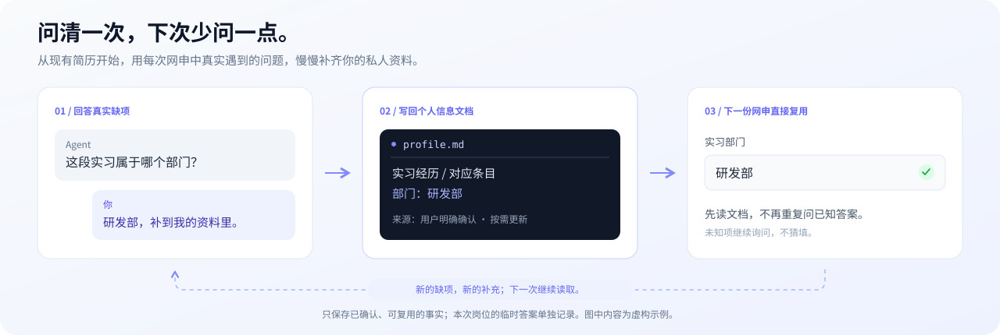
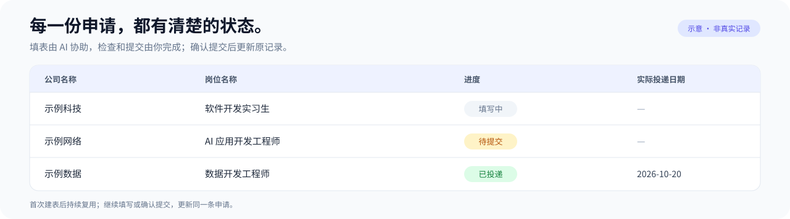

<div align="center">

# LessFill

**简体中文** · [English](README.en.md)

**多留一点时间准备面试**

让 AI 根据你的简历填写网申、上传附件，再把每次申请记录进你的求职表格。

[](LICENSE)
[](resume-autofill/SKILL.md)
[](#目前能做到什么)

[开始使用](#开始使用) · [让资料越用越完整](#让个人信息文档越用越完整) · [浏览器怎么选](#浏览器怎么选) · [飞书怎么接](#飞书怎么接)

</div>

---

> **博主本人亲测投递 300 份简历，持续磨合而成。**
>
> 这套 skill 是我在真实求职中，一次次填表、排错、调整流程打磨出来的，也是我目前打磨出的最佳版本。现在把它整理开源，希望你能少走一些弯路。

换一个招聘官网，教育经历、实习、项目、奖项又要填一遍。附件传完了，还得想起来把投递记录补上。

LessFill 把这些重复步骤整理成一套可复用的 Agent Skill。你提供简历、照片和招聘链接，AI 按页面的实际字段填写，能保存的先保存；最后一遍检查和正式提交，留给你。

它是一套供 AI 工具执行的工作流程。**需要你的 AI 工具具备文件读取、浏览器控制等能力，安装 skill 不会自动安装浏览器插件或开通账号。**

LessFill 使用 [Agent Skills](https://agentskills.io/specification) 目录格式。支持该格式的 Agent 可原生加载；具备文件读取和浏览器工具的其他 Agent，也可直接读取 `SKILL.md` 执行。底层模型可以不同，实际操作能力由你使用的 Agent / harness 提供。

## 一眼看懂整个流程


<p align="center"><sub>你准备资料 → AI 填写、整理记录 → 你检查、提交。</sub></p>

## 你提供什么，它做什么

|你提供|Skill 处理|
|:---|:---|
|简历文件路径或可访问链接|提取填表需要的资料，后续复用；你的修正优先于旧简历|
|照片文件，可选|在页面要求且工具支持时上传，不用简历截图冒充证件照|
|招聘链接|识别公司、岗位和字段，按区块填写，避免重复添加经历|
|浏览器选择|使用 Chrome＋Jev 或 Edge＋Playwright，复用对应会话|
|飞书方式选择|首次授权后建表，后续把申请写进同一张表|

默认会上传已授权的简历和照片、保存草稿。**默认不会最终提交申请，也不会替你处理验证码或签名。** 没有依据的信息会留空或询问，不会为了填满表单编造经历、成绩和日期。

## 开始使用

### 1. 安装 skill

项目名称是 LessFill，安装后的 skill 名称为 `resume-autofill`，下方示例可直接使用。

**跨 Agent 安装**，有 Node.js 环境时可以使用 [Skills CLI](https://www.skills.sh/docs/cli)，按提示选择目标 Agent 和安装范围：

```sh
npx skills add lgh88666/lessfill
```

这是可选的第三方安装工具，不是运行依赖。

<details>
<summary><strong>手动安装、Codex 安装，以及没有原生 Skill 功能的 Agent</strong></summary>

也可下载仓库，按对应 Agent 的官方文档放置整个 `resume-autofill/` 目录：

|Agent / 使用方式|放置或调用方式|
|:---|:---|
|[Claude Code](https://code.claude.com/docs/en/skills)|项目内 `.claude/skills/resume-autofill/`，可用 `/resume-autofill` 调用|
|[Cursor](https://cursor.com/docs/skills)|项目内 `.cursor/skills/resume-autofill/`，由 Agent 加载使用|
|[OpenCode](https://opencode.ai/docs/skills/)|项目内 `.opencode/skills/resume-autofill/`，由技能工具加载|
|Codex|使用下面的 `skill-installer` 入口，或放进已配置的技能目录|
|其他 / 自建 Agent|原生加载 Agent Skills，或按下方通用提示直接读取文件|

表中是各客户端公开的加载方式，不代表本项目已经完成这些客户端的端到端实测。浏览器和附件能力需要分别接好。

**在 Codex 中**，可以把这句话发给支持技能安装的会话：

```text
使用 skill-installer 安装：
https://github.com/lgh88666/lessfill/tree/main/resume-autofill
如果已有同名 skill，请先告诉我，不要覆盖。
```

**使用其他 AI 工具**，下载本仓库，将 [`resume-autofill/`](resume-autofill/) 放进该工具支持的技能目录。实际入口是 [`SKILL.md`](resume-autofill/SKILL.md)；支持读取本地文件的 agent 也可以按你的指示读取它。Codex 的界面元数据位于 `agents/openai.yaml`，其他工具可以忽略。

安装方式以你的宿主工具为准。可参考 [OpenAI 的技能说明](https://learn.chatgpt.com/docs/build-skills)。

**不支持原生 skill 的 Agent**，也可以在下载后这样调用：

```text
请读取 <本地仓库绝对路径>/resume-autofill/SKILL.md，并按需读取它引用的文件。
使用你当前实际提供的文件工具和浏览器工具执行，不依赖 Codex 专用接口。
先读取我的私人配置：<config.json 的路径；首次使用可省略>
填写这个网申：<招聘网址>。允许上传及保存，不提交。
```

DeepSeek 等模型可以通过具备这些工具的 harness 执行流程；仅更换聊天模型不会自动获得浏览器能力。跨 Agent 适配规则见[工具适配说明](resume-autofill/references/agent-integration.md)。

</details>

### 2. 准备一个浏览器连接

选择你已经在使用的一条路线即可：

- **Chrome＋Jev**：配置好 Jev，在它实际控制的 Chrome 会话登录招聘网站。
- **Edge＋Playwright**：连接你现有的 Edge；宿主有可用的内置 Playwright 时可直接复用，使用独立 MCP 扩展时可能需要首次选页。

具体差别见[浏览器怎么选](#浏览器怎么选)。不需要为这个 skill 同时配置两套。

### 3. 发出第一条申请

把下面的路径和网址替换成你自己的：

```text
使用 resume-autofill 填写这份网申：<招聘网址>

简历：<本地简历路径或下载链接>
照片：<本地照片路径或下载链接，没有可暂不提供>
浏览器：Edge＋Playwright
飞书：通过浏览器操作，不接入飞书 MCP

允许把所提供资料填入该招聘网站，上传简历和照片，并保存草稿。
请在首次使用时创建一份私有飞书投递表，以后复用。
填完交给我检查，不要提交申请。
```

你也可以只提供简历和网址，让 AI 集中询问剩下的选择。首次初始化会保存资料路径、浏览器偏好和飞书表格信息，后续不用从头配置。

### 4. 下一家公司，发链接就好

在同一工作目录下，新聊天可以这样开始：

```text
使用 resume-autofill，读取已有配置，填写这个网申：<新招聘网址>
```

换了工作目录或 AI 工具，请同时提供私人 `config.json` 的路径。资料保存到本地后，不代表任意聊天都会自动找到它。

## 让个人信息文档越用越完整

**第一次不用准备一份完美的个人档案，从现有简历开始就行。** 招聘表单会问到简历没写的细节，例如实习部门、奖项时间、专业课程。遇到这些问题，Agent 会集中向你询问，你的回答再补回私人 `profile.md`。



> [!TIP]
> **把 Agent 的追问当成完善个人信息文档的机会。**
> 每次回答完，可以加一句：“把这条补进我的个人信息文档，以后填表复用。”你也可以直接打开文档修改，下次使用前 Agent 会重新读取。

### 一次小补充，省掉后面的重复回答

|对话|发生的变化|
|:---|:---|
|**Agent：**“这份表要求填写实习部门，简历里没有，这段实习属于哪个部门？”|找到真正缺失的字段，不猜填|
|**你：**“研发部，写进个人信息文档，以后复用。”|确认一条可以长期使用的事实|
|**Agent：**“已补入 `profile.md` 的这段实习，来源为你本次确认。”|更新对应经历，保留其他资料|
|**下一份网申：**先读取个人信息文档|已有答案直接使用，不重复询问|

表中的对话是使用示例。实际资料始终以你的简历和明确回答为准。

需要逐步补充的内容，可以从这几类开始：

|🎓 教育|💼 经历|🏅 奖项|⚙️ 使用偏好|
|:---|:---|:---|:---|
|院系、课程、成绩口径|部门、工作地点、起止时间|名称、级别、获奖年月|浏览器、附件、飞书方式|

**已经确认的事实，才写回文档。** 本次岗位的期望薪资、意向城市等通常只属于这次申请，Agent 会单独记在本次申请里；你明确说是长期偏好时，才用于以后。暂时不知道的内容可以留空，不需要为了回答问题编出一个值。

## 浏览器怎么选

|路线|适合的情况|先了解这一点|
|:---|:---|:---|
|**Chrome＋Jev**|已经使用 Jev，希望把多步页面操作交给它|Jev 可能控制独立的持久 Chrome，也可能通过扩展连接；登录要在实际受控会话完成|
|**Edge＋Playwright**|平时用 Edge，希望按字段批量填写|内置 Playwright 与独立 MCP 是不同连接；其中一个失败，不代表另一个也不可用|

Skill 优先用字段接口成批填写，特殊控件才局部使用截图或坐标操作，避免每填一个框就重新读取整页。

它会区分浏览器会话：不会因为另一个窗口显示登录页，就断言你原来的窗口没登录。连接停在授权或选页页面时，会说明需要完成哪一步，而不是反复新建连接页。

**附件上传取决于浏览器工具的实际能力。** 文件在本机、浏览器在远端时，还需要宿主支持文件传输；仅把本地路径填进文本框不算上传成功。当前工具做不到时，会保留表单并告诉你还需手动上传什么。

工具文档：[Jev Browser Control](https://jevbrowsercontrol.com/docs) · [Playwright MCP](https://github.com/microsoft/playwright-mcp)

## 飞书怎么接

**飞书 MCP 是可选项。** 第一次使用时，你自己选一种，之后继续复用：

|方式|需要准备|建表和记记录如何完成|
|:---|:---|:---|
|**浏览器**|在受控浏览器登录飞书，账号有建表和编辑权限|直接操作飞书页面；不需要飞书自建应用或 App Secret|
|**MCP**|接入飞书 MCP，并授予相应权限|通过工具创建和读写；只有记录读写权限时，仍不足以首次建表|

选择 MCP 后，不会因为连接失败就悄悄改用浏览器。你可以明确允许回退，也可以稍后更换方式；**更换方式仍使用原来的表，不另外新建一张。** 不需要投递表时，也可以关闭飞书记录。

首次建表完成，会返回表格链接并把它保存在你的私人配置中。新申请会新增记录，继续填写同一岗位则更新原记录。

### 填完和投递成功，分开记录



<sub>示意图使用虚构公司和岗位，展示默认记录方式，并非真实投递截图。</sub>

默认表格包含公司、岗位、工作地点、进度、申请链接、申请标识、记录日期和投递日期。没提交时记为“待提交”，实际投递日期留空；你告知已提交后，更新同一条记录。

如果你有自己的记账习惯，可以明确调整状态口径。表格状态始终不代替招聘网站的真实提交结果。

## 你的资料存在哪里

默认在使用时的工作目录下创建私人目录：

```text
.resume-autofill/
├── config.json           # 文件路径、浏览器及飞书方式
├── profile.md            # 从简历导入的事实和你的修正
├── tracker-state.json    # 飞书链接、可获取的 ID 和字段映射
├── applications.json     # 本次申请标识和待补写记录
└── files/                # 按需缓存的简历、照片
```

也可以指定其他私人目录。相对路径以配置文件所在目录为基准。

**“本地保存”不等于“资料从不离开本机”。** 填表和上传会把相应资料交给招聘网站；模型及浏览器代理会按各自工具的数据处理方式接收任务信息；启用飞书后，申请记录会写入飞书。Skill 要求只向工具传入当前步骤所需资料，不默认传整份私人档案。

仓库只包含流程和虚构示例，不需要你上传真实简历或密钥。请把私人目录排除在版本控制之外；本仓库的 `.gitignore` 已提供常见忽略规则。

<details>
<summary><strong>配置示例：浏览器填写飞书，允许上传和保存，不提交</strong></summary>

以下为关键字段节选，完整结构见 [`config.example.json`](resume-autofill/examples/config.example.json)。初始化由实际授权生成，复制示例本身不等于授权。

```json
{
  "browser": { "mode": "edge-playwright" },
  "actions": {
    "upload_resume": true,
    "upload_photo": true,
    "save": true,
    "submit": false,
    "final_review": "user"
  },
  "tracker": {
    "enabled": true,
    "transport": "browser",
    "allow_browser_fallback": false,
    "status_after_fill": "待提交",
    "date_on_fill": false
  }
}
```

`transport` 可以是 `browser` 或 `mcp`；首次示例里的 `null` 表示尚未选择。想关闭记录，将 `tracker.enabled` 设为 `false`。其他设置及恢复流程见[首次使用说明](resume-autofill/references/setup.md)。

</details>

## 常见问题

**装好 skill 就能用吗？**

还需要宿主能读取文件、操作所选浏览器。飞书通过浏览器操作时无需 MCP；通过 MCP 操作时，另需接入和授权。Skill 不捆绑这些服务。

**需要把整个个人信息文档发给浏览器代理吗？**

不需要。按区块提供本步要填的字段即可。简历附件本身只在用户已授权、页面需要上传时交给招聘网站。

**Agent 问了我一些简历里没有的问题，需要每次重答吗？**

确认过且适合复用的事实会补进私人 `profile.md`。后续使用相同配置时先读取它，已有信息不再重复问。本次岗位的临时答案单独保存；你不想记录的内容也可以明确说明。

**简历链接打不开，或者扫描版读不出怎么办？**

可以直接提供本地文件。需要登录的链接先在对应浏览器登录；扫描版需要环境有 OCR。读取失败会明确说明，不会把缺失信息当作“没有”。

**每家公司都得重新登录、拖标签吗？**

有效会话会复用。新连接或新标签超出当前授权范围时，可能需要选页；已经能访问目标页就不需要额外拖动。多个聊天同时控制同一页面容易互相影响，尽量给各自独立的目标标签。

**有必要做一遍整表核对吗？**

默认不由 AI 逐字段回读，最后交给你检查。操作失败、附件被拒收、保存未成功仍会处理，不会把报错留给你猜。

**能保证每个招聘网站都能填吗？**

不能。自定义日期控件、文件选择器、站点风控及工具权限都可能影响操作。遇到阻碍会说明已完成和待接手的部分，不绕过登录或验证。

## 目前能做到什么

公开版是在上述个人使用经验的基础上，拆出私人配置、补充通用流程后整理而成。目前是 **Workflow Preview**：包含资料导入、两种浏览器路径、附件上传约定，以及飞书首次建表、后续复用和写入恢复流程。

当前版本已做 skill 格式及配置 JSON 校验，**尚未完成公开版两条浏览器路径、附件上传和飞书建表的完整端到端验证**。仓库没有后台服务、定时自动投递或未经验证的网站兼容清单。欢迎从你实际使用的一个招聘站点开始反馈。

## 参与改进

遇到卡住的页面，可以[提交 Issue](https://github.com/lgh88666/lessfill/issues/new/choose)，说明使用的 AI 工具、浏览器路线、卡在哪一步，以及去掉个人信息后的错误提示。不要附真实简历、完整私人配置、身份证号、cookie 或密钥。

欢迎改进字段映射、连接提示、上传流程和文档。提交 PR 时说明解决了什么实际问题，以及是否在真实页面验证；未验证的部分请直接注明。

## 项目结构

```text
resume-autofill/          # 可安装的 skill
├── SKILL.md             # 入口与核心流程
├── agents/              # Codex UI 元数据
├── examples/            # 无真实个人信息的配置和资料示例
└── references/          # 浏览器、上传及飞书的按需说明
docs/assets/             # README 图示
```

## 致谢与许可

浏览器执行依赖你选择的工具，感谢 [Playwright MCP](https://github.com/microsoft/playwright-mcp) 和 [Jev Browser Control](https://jevbrowsercontrol.com/docs)。本项目为独立社区项目，与招聘网站、飞书及上述工具不存在官方关联。

[MIT License](LICENSE) · Made by [lgh88666](https://github.com/lgh88666)
